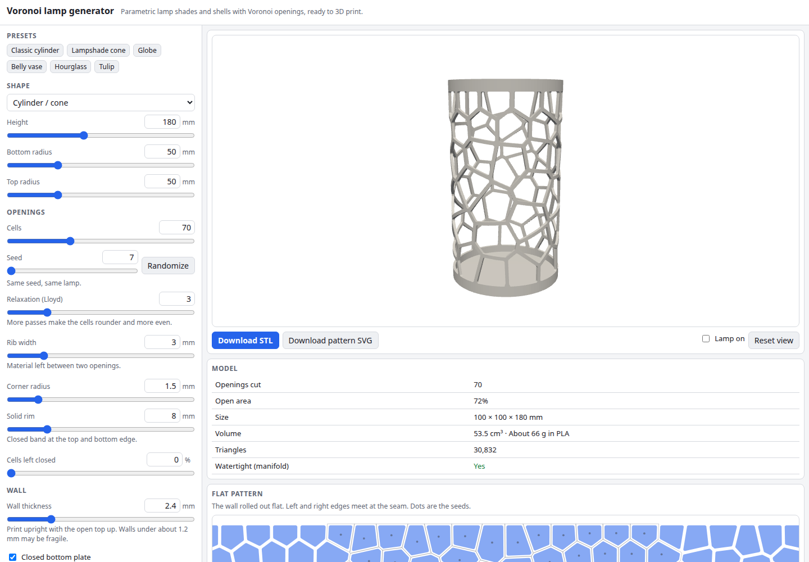

# Voronoi Lamp Generator

Design a 3D-printable lamp shade, vase or globe whose wall is cut into Voronoi cells. Pick a cylinder, cone, sphere or free vase profile, set the number of cells, the rib width and the wall thickness, spin it around in 3D and download a watertight STL. Everything runs in your browser.

**Try it: [hermes98761234.github.io/voronoi-lamp-generator](https://hermes98761234.github.io/voronoi-lamp-generator/)**

[](https://github.com/hermes98761234/voronoi-lamp-generator/actions/workflows/deploy.yml)



## Features

- **Parametric shapes.** Cylinder or cone, sphere with cut-off caps, or a vase profile defined by five radii and joined by a smooth curve. Six presets to start from.
- **Voronoi openings.** Seeded random points with a soft minimum spacing, **Lloyd relaxation** to even out the cells, a minimum **rib width**, rounded corners, a solid rim and an optional share of cells left closed. The same seed always gives the same lamp.
- **A real wall.** Wall thickness along the surface normal, optional closed bottom plate, and a clamp that keeps the inner skin off the axis.
- **Watertight STL.** The solid is built with [Manifold](https://github.com/elalish/manifold) (WebAssembly): revolved wall, minus the openings, plus the base. Binary STL in millimetres, with volume and an estimated PLA weight shown.
- **3D preview** (Three.js) with orbit controls and a "Lamp on" mode that puts a light inside and casts the pattern onto the floor.
- **Flat pattern.** The wall rolled out flat, also downloadable as an SVG in millimetres.
- **English or Ukrainian, light, dark or system theme.** Settings are remembered in the browser. No backend, no tracking, nothing is uploaded.

## How it works

The wall is unwrapped into a rectangle with an **equal-area** mapping: x runs around the lamp, y runs up the wall, scaled so that area is preserved. A uniformly random seed in the rectangle is therefore uniformly random on the real surface, even on a sphere or a vase with a narrow neck. The rectangle is periodic in x, so seeds are copied one width to the left and right and [d3-delaunay](https://github.com/d3/d3-delaunay) computes the Voronoi diagram of all three copies. The cells of the middle copy are the cells on the lamp, and they match up across the seam.

Each cell is shrunk by half the rib width, measured in true millimetres with the local stretch of the mapping, and its corners are rounded. The outline is mapped back onto the surface and pushed through the wall along the surface normals, which gives one cutter solid per opening. In a Web Worker, Manifold revolves the wall cross-section, subtracts the union of all cutters and adds the base plate. The result is checked to be a manifold, and its volume and genus are reported.

The tests check the geometry against textbook values: the lateral area of a cylinder, a cone and a sphere zone (Archimedes), the area of a polygon offset (Steiner formula), that Voronoi cells tile the band exactly, that Lloyd relaxation evens the cell sizes, the volume of a tube against pi h (R^2 - r^2), and that the volume removed by the openings matches the open area times the wall thickness.

## Quick start

You need [Node.js](https://nodejs.org/) 22.

```bash
git clone https://github.com/hermes98761234/voronoi-lamp-generator.git
cd voronoi-lamp-generator
npm install
npm run dev       # http://localhost:5173
npm test          # geometry, Manifold build, STL and i18n tests
npm run build     # static site in dist/
```

Print the lamp upright. Walls thinner than about 1.2 mm may be fragile, and very thin ribs can break when removed from the bed.

## License

MIT
